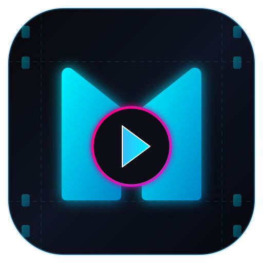

# 🎬 MOVIE MATRIX — Stream Movies & TV Shows



> **Movie Matrix** is a modern, high-performance, cinematic web application designed for streaming, discovering, and managing movies and TV shows. Featuring a sleek dark design system, seamless multi-language support (English & Hindi), dynamic color theme engines with radial ripple transitions, real-time search & filtering, interactive trailer playback, and a hybrid architecture blending modular Vanilla JavaScript with in-browser React 18 components.

---

## 🌟 Key Features

### 🎬 1. Cinematic Landing & Intro Experience
- **Poster Wall Canvas**: Immersive fullscreen poster wall background with dark gradient vignettes and grain overlays.
- **Splash Screen Loader**: Smooth loading ring animation with automatic anti-flash session state memory.
- **Meet the Team**: Dedicated team showcase section highlighting project contributors.

### 🎨 2. Multi-Theme Customization System
- **4 Curated Dark Themes**:
  - 🌌 **Midnight Matrix** *(Default: Cool Sky Blue & Navy)*
  - 💜 **Cyber Neon** *(Electric Magenta & Deep Violet)*
  - 🌊 **Ocean Noir** *(Teal & Emerald Green)*
  - 🌅 **Sunset Cinema** *(Warm Amber, Crimson & Coral)*
- **Theme Ripple Animation**: Fullscreen radial ripple transition when changing themes.
- **Keyboard Shortcut**: Press **`T`** anywhere on the site to cycle through themes instantly.

### 🌐 3. Real-Time Internationalization (i18n)
- Seamless dynamic language switching between **English (`en`)** and **Hindi (`hi`)**.
- Powered by a dictionary-driven translation engine ([`js/language.js`](js/language.js)) that updates DOM elements and React components without requiring page reloads.

### ⚛️ 4. Hybrid Architecture (Vanilla JS + React 18)
- Built with modular Vanilla JS for speed and zero build-step requirement.
- Includes an integrated **React 18 Sandbox** parsed directly in-browser using Babel Standalone:
  - `MovieCard.jsx` — Reusable card with hover action overlays, badges, and click triggers.
  - `MovieGrid.jsx` — Responsive grid component.
  - `SearchBar.jsx` — Search input with instant clearing capabilities.
  - `FilterPanel.jsx` — Media type tabs and genre dropdown selectors.

### 🔍 5. Advanced Search & Filtering System
- Instant multi-field search query matching (Title, Cast, Genre, Description).
- **Search Highlighting**: Automatically highlights matching search terms with theme-accented `<mark>` tags.
- Filtering by Media Type (*All Types*, *Movies*, *TV Shows*) and Genre (*Action*, *Sci-Fi*, *Drama*, *Comedy*, etc.).

### 🎬 6. Interactive Movie Details & Trailer Player
- **Details Modal**: Detailed view displaying movie synopses, release year, age ratings, cast lists, match percentage scores, and an interactive star rating widget.
- **Dedicated Video Player Modal**: Full-screen YouTube trailer playback modal cleanly decoupled from the metadata view.

### ➕ 7. Watchlist ("My List") Management
- Bookmark movies and TV shows to a personal watchlist.
- Real-time badge counter update in the navigation header (`My List (Count)`).
- Persistent storage using browser `localStorage`.

### 👤 8. User Session & Authentication Modal
- Sign In / Sign Up modal equipped with **real-time password security validation**:
  - Minimum 8 characters requirement
  - Capital letter requirement
  - Special character requirement
- Integrated **Google OAuth** UI trigger and **Guest Mode** access.

### 📱 9. 100% Responsive Design System
- Engineered mobile-first to deliver optimal layouts across mobile devices (down to 320px width), tablets, laptops, and ultra-wide desktop monitors.
- Supports native touch swipe momentum (`scroll-snap-type`) for movie carousels.

---

## 🛠️ Technology Stack

| Domain | Tech / Tools Used |
| :--- | :--- |
| **Core Architecture** | HTML5, Vanilla JavaScript (ES6+ Modules) |
| **Styling & Design** | Modern CSS3, Custom Properties / Design Tokens, Flexbox, CSS Grid |
| **UI Library / Component Framework** | React 18 (UMD), ReactDOM 18, Babel Standalone |
| **Typography** | Google Fonts (*Inter*, *Noto Sans Devanagari*) |
| **Icons & Branding** | Custom Vector SVG Assets, `favicon.svg` |
| **Storage & Persistence** | Browser `localStorage` (Theme, Language, Watchlist, Auth session) |

---

## 📁 Project Directory Structure

```gfm
Paras/
├── index.html                  # Main Application & Landing Page Entry Point
├── movies.html                 # Dedicated Movies View
├── tvshows.html                # Dedicated TV Shows View
├── script.js                   # Master Module Loader Reference
├── style.css                   # Main Entry Stylesheet
├── favicon.svg                 # Futuristic Vector SVG Favicon
│
├── assets/                     # Media & Graphics
│   ├── favicon.svg             # Project Favicon Icon
│   ├── cyber_heist.jpg         # Movie Posters & Wallpapers
│   ├── matrix_awakens.jpg
│   ├── neon_skies.jpg
│   └── ... (SVG & JPG assets)
│
├── css/                        # Modular CSS Design System
│   ├── global.css              # Color Variables, Themes, Resets, Toasts, Animations
│   ├── navbar.css              # Navigation Header, Search Box, Language & Theme Pickers
│   ├── hero.css                # Cinematic Hero Banner, Carousel Controls, Progress Fill
│   └── components.css          # Movie Cards, Sliders, Grids, Modals & React Sandbox Styles
│
├── js/                         # Modular Application Logic
│   ├── data.js                 # Media Catalog & Category Configurations
│   ├── intro.js                # Landing Screen Overlay & Anti-Flash Loader
│   ├── language.js             # Dual Language i18n Translation Engine (EN / HI)
│   ├── theme.js                # Theme Engine & Radial Ripple Animation Controller
│   ├── hero.js                 # Hero Banner Carousel & Auto-Slide Logic
│   └── app.js                  # Main Application Router, State Manager & Event Controllers
│
└── react/                      # React 18 Component Sandbox
    ├── main.jsx                # React Mount Point
    ├── App.jsx                 # Main React App Wrapper & State Manager
    └── components/             # Reusable JSX Components
        ├── MovieCard.jsx       # Interactive Movie Card Component
        ├── MovieGrid.jsx       # Grid Layout Component
        ├── SearchBar.jsx       # Search Input Component
        └── FilterPanel.jsx     # Media & Genre Filter Panel Component
```

---

## 🚀 Getting Started

No build process or NPM installation is required! You can run the project using any standard HTTP web server.

### Option 1: Python HTTP Server (Recommended)
Open your terminal in the root directory of the project and execute:

```bash
# Python 3
python -m http.server 8080
```

Then visit [`http://localhost:8080`](http://localhost:8080) in your web browser.

### Option 2: VS Code Live Server
1. Open the project folder in **Visual Studio Code**.
2. Install the **Live Server** extension.
3. Right-click on `index.html` and select **"Open with Live Server"**.

---

## ⌨️ Keyboard Shortcuts

| Key | Action |
| :---: | :--- |
| <kbd>T</kbd> | Toggle between color themes (*Midnight Matrix*, *Cyber Neon*, *Ocean Noir*, *Sunset Cinema*) |
| <kbd>Esc</kbd> | Close active modal (*Movie Details*, *Trailer Video Player*, or *Auth Modal*) |

---

## 👥 Meet the Team

| Team Member | Role & Responsibilities |
| :--- | :--- |
| **Angel Arora** | UI / UX Design & Frontend Development |
| **Paras Walia** | Core Functionality & Application Architecture |
| **Garima Bhel** | Content Management & Quality Assurance |
| **Udayvir Singh** | Data Collection, Movie Research & Documentation |

---

## 📄 License

Copyright © 2026 **Movie Matrix**. All rights reserved.
